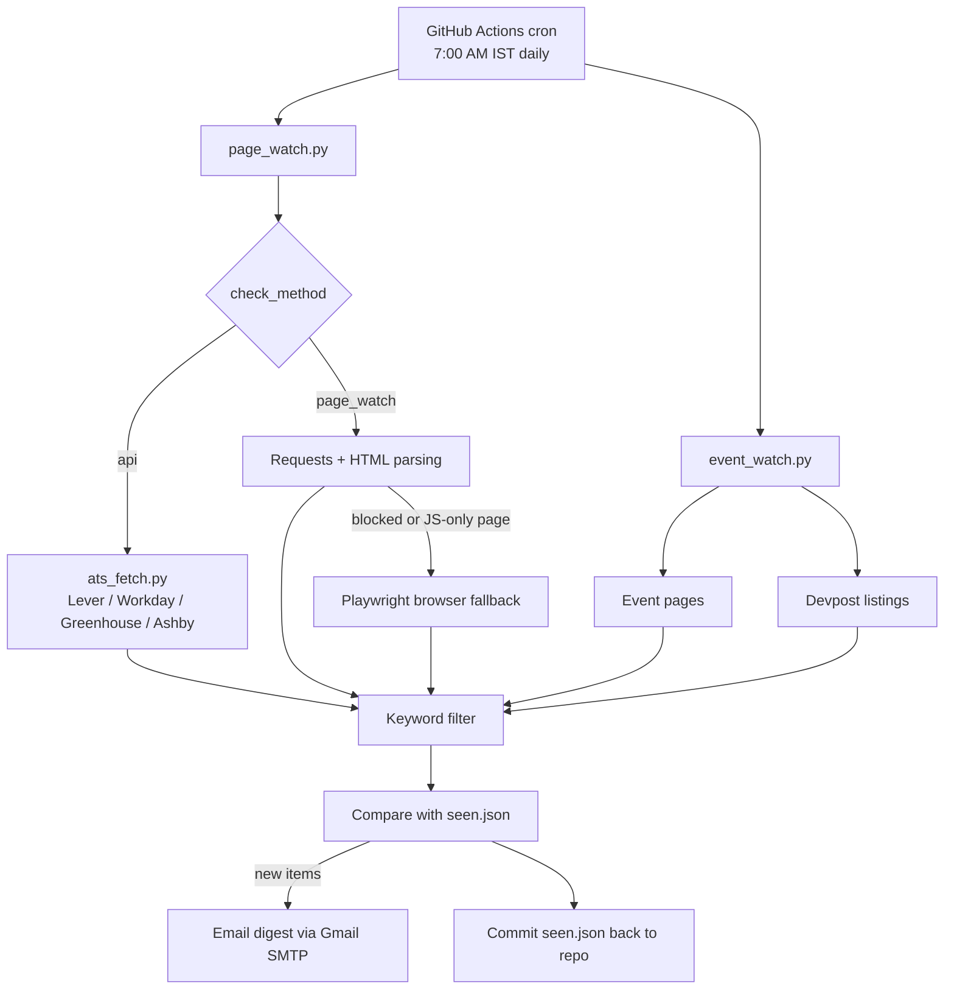

# Internship Job Alert Agent

An automated pipeline that checks company career pages, job-board feeds and hackathon pages every morning and emails me **only what is new**, with direct links to apply.

It runs for free on GitHub Actions, so no server and no always-on laptop are needed.

<!-- Add a screenshot of an alert email here:  -->

## Why I built it

Internship postings at big companies open and close quickly, and most companies have no email alert for them. Checking ~100 career pages by hand every day does not scale, so this does it for me.

## Features

- **Three kinds of sources**
  - Direct job feeds (Lever, Workday, Greenhouse, Ashby) for exact titles, locations and apply links.
  - Career and early-careers pages, read with plain requests, or a headless browser (Playwright) when a page is blocked or rendered with JavaScript.
  - Hackathon and competition pages, plus open and upcoming hackathons discovered on Devpost.
- **Only new items trigger an email.** Each source is compared against saved state, so you never see the same posting twice.
- **Safe first run.** A company seen for the first time is recorded as a baseline and does not flood the inbox.
- **Priority ordering.** Digests list `dream` companies first, then `target`, then `backup`.
- **Health reporting.** Every digest shows how many sources were checked and which failed to load, and a weekly status email arrives on Mondays even when nothing is new.
- **Failure-safe state.** If the email fails to send, the saved state is rolled back so the finds are reported on the next run.
- **Free and serverless.** A daily cron job on GitHub Actions, with secrets stored in GitHub Secrets.

## How it works



1. **Collect.** For each company, fetch jobs from its feed, or pull links and text lines from its career pages.
2. **Filter.** Keep links and lines that match keywords such as *intern*, *2027* or *campus*, and drop excluded words such as *senior*.
3. **Compare.** Check each match against `seen.json`. Anything not seen before is new.
4. **Notify.** Email a digest of the new items, sorted by priority, with a health summary.
5. **Persist.** Save the updated `seen.json` back to the repository so the next run starts from it.

## Project structure

```
.
├── .github/workflows/daily.yml   # daily schedule + manual run (with optional test email)
├── page_watch.py                 # main company scanner and digest
├── ats_fetch.py                  # direct feed fetchers (Lever, Workday, Greenhouse, Ashby)
├── event_watch.py                # hackathon / competition watcher
├── notify_email.py               # Gmail SMTP sender
├── companies.csv                 # companies to watch
├── events.csv                    # events to watch
├── config.yaml                   # keywords, exclusions, locations
├── seen.json                     # saved state (updated by the daily run)
├── detect_ats.py                 # fills ats_type / slug from a careers URL
├── check_urls.py                 # finds broken URLs in companies.csv
├── skip_companies.py             # change check_method for named companies
├── add_companies.py              # bulk-add companies (one-off helper)
├── requirements.txt              # local dependencies
└── requirements-ci.txt           # slim dependencies for GitHub Actions
```

## Setup

### 1. Run it locally

```bash
git clone https://github.com/<your-username>/internship-job-alert-agent.git
cd internship-job-alert-agent

python -m venv .venv
# Windows PowerShell:  .venv\Scripts\activate
# macOS / Linux:       source .venv/bin/activate

pip install -r requirements.txt
pip install playwright
playwright install chromium        # only needed for blocked / JavaScript-heavy pages
```

Create a `.env` file (never commit it) with a Gmail **App Password**. You need 2-Step Verification turned on in your Google account to create one.

```
EMAIL_ADDRESS=you@gmail.com
EMAIL_APP_PASSWORD=your16charapppassword
EMAIL_TO=you@gmail.com
```

Test the email, then do a first scan:

```bash
python notify_email.py                # should send "Job Agent test"
python page_watch.py --limit 5        # scan a few companies (first run records a baseline)
python page_watch.py                  # scan everything
python event_watch.py                 # scan events
```

### 2. Run it daily on GitHub Actions

1. Push the project to a **private** repository.
2. In the repository, open **Settings → Secrets and variables → Actions** and add three repository secrets: `EMAIL_ADDRESS`, `EMAIL_APP_PASSWORD`, `EMAIL_TO`.
3. Open **Actions → Daily job scan → Run workflow**. Tick *Send a test email first* the first time to confirm the email login works.

The schedule is in `.github/workflows/daily.yml`. The cron time is in UTC, so `30 1 * * *` is 7:00 AM IST.

## Configuration

### companies.csv

| Column | Meaning |
|---|---|
| `company` | Company name |
| `sector` | Free-text label |
| `careers_url` | Main careers or job search page |
| `early_careers_url` | Students / early careers page (optional) |
| `ats_type` | `greenhouse`, `lever`, `ashby`, `workday` or `custom` (filled by `detect_ats.py`) |
| `slug` | ATS board name (filled by `detect_ats.py`) |
| `priority` | `dream`, `target` or `backup` (controls order in the digest) |
| `check_method` | `api`, `page_watch`, `needs_browser`, `skip` or `needs_url` |
| `notes` | Free text, not used by the scanner |

`check_method` values:

- `api`: use the company's job feed (`ats_type` must be set).
- `page_watch`: read the career pages.
- `needs_browser`: like `page_watch`, but expected to need the Playwright browser.
- `skip`: ignore this company.
- `needs_url`: missing a usable URL.

### config.yaml

Controls the keywords that make a link or line interesting (`page_watch_keywords`), the words that exclude it (`roles_exclude`), and related settings. Event keywords and locations have built-in defaults and can be overridden with `event_keywords` and `event_locations`.

### Useful commands

```bash
python detect_ats.py                                   # fill ats_type / slug from URLs
python check_urls.py                                   # report broken URLs
python skip_companies.py --method api Palantir         # change a company's check_method
python skip_companies.py "Company Name"                # skip a company
python page_watch.py --only "Company Name"             # test one company
python page_watch.py --email                           # scan and email new finds
python page_watch.py --email --status                  # also send a status email if nothing is new
```

## Design decisions

- **Plain code first, no LLM.** Fetching, filtering, deduplication and link handling are deterministic Python. This keeps runs repeatable and free of API quotas.
- **Baseline on first sight.** Existing menu links and open roles are recorded silently, so alerts only mean something changed.
- **A browser only when needed.** Plain HTTP is fast and cheap. Playwright is used only for blocked or JavaScript-rendered pages.
- **State in the repository.** `seen.json` is committed by the workflow, which is simpler than a database and keeps history in git.
- **Polite scraping.** Delays between requests, a descriptive user agent, and no logins or CAPTCHA bypassing. LinkedIn is not scraped, because it violates their terms.

## Limitations

- **Keyword matching is approximate.** Expect some noise, such as a banner that mentions internships, and some misses.
- **Some sites block automation entirely.** Those are marked `skip`, and their own email alerts work better.
- **Page matches can lack a direct apply link.** The digest then points to the page the match came from.
- **Some endpoints are unofficial.** Workday's job search and Devpost's listing feed are not documented APIs and can change without notice.
- **GitHub scheduled runs can start late**, sometimes by several minutes to an hour.

## Roadmap

- [ ] LLM ranking (Google ADK + Gemini) that adds a "why this matches you" line to each alert
- [ ] LinkedIn job-alert email parsing and an aggregator API (for example Adzuna) to discover companies not in the list
- [ ] Application tracker (applied / interview / offer) to avoid re-alerting on handled roles
- [ ] Per-link extraction for text-only matches

## Tech stack

Python · Requests · BeautifulSoup · Playwright · GitHub Actions · Gmail SMTP

## Disclaimer

For personal use. Respect each site's terms of service and robots.txt, keep request rates low, and verify every posting on the company's official site before applying.
